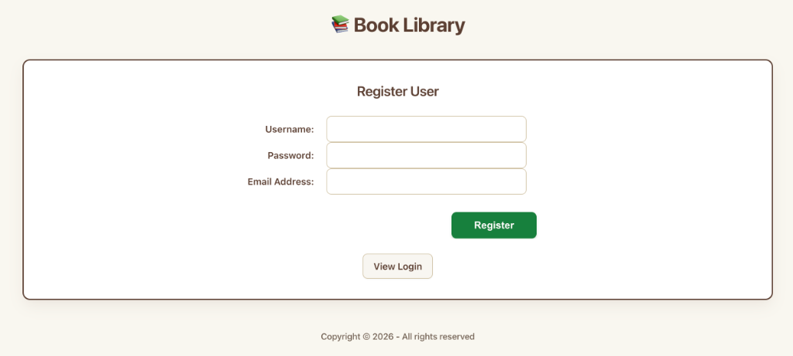
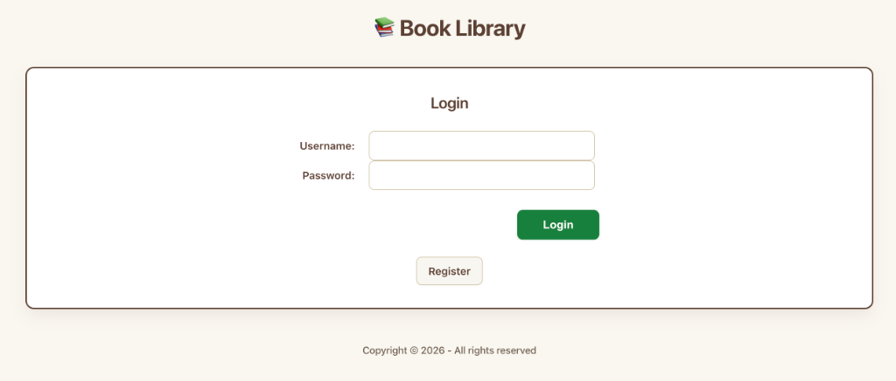
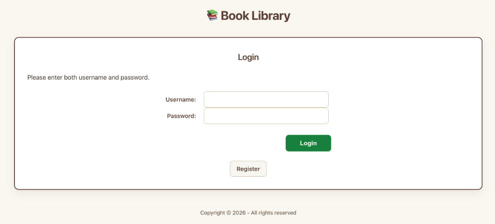
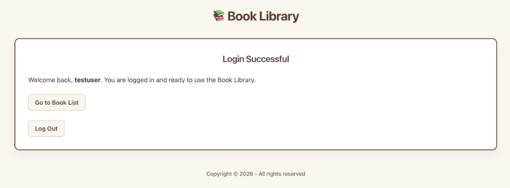

# 📚 BookVault — Full-Stack PHP & MySQL Library Management System

[](https://www.php.net/)
[](https://www.mysql.com/)
[](https://www.apachefriends.org/)
[](https://www.php.net/manual/en/book.pdo.php)
[](LICENSE)

A modern, secure, and production-ready library management web application built with **PHP 8** and **MySQL/MariaDB**. Designed with clean software architecture principles, the platform provides complete catalog lifecycle management, relational data modeling, an automated dual-tier image processing pipeline, multi-tenant per-user data isolation, and comprehensive account defense mechanisms against brute-force attacks and session tampering.

---

## 📑 Table of Contents

- [Core Capabilities & Architectural Highlights](#-core-capabilities--architectural-highlights)
- [Key Features](#-key-features)
- [Screenshots & Visual Walkthrough](#-screenshots--visual-walkthrough)
  - [Authentication & Account Security](#1-authentication--account-security)
  - [Catalog Management & Book Details](#2-catalog-management--book-details)
- [System Architecture & Database Schema](#-system-architecture--database-schema)
- [Security Architecture](#-security-architecture)
- [Installation & Local Setup](#-installation--local-setup)
- [Multi-User Isolation Verification](#-multi-user-isolation-verification)
- [Project Structure](#-project-structure)
- [Author & License](#-author--license)

---

## 🚀 Core Capabilities & Architectural Highlights

| Engineering Pillar | Implementation Focus | Technical Highlights |
| :--- | :--- | :--- |
| **Relational Data Architecture** | Schema Design & Normalization | InnoDB engine with referential integrity, foreign key constraints (`fk_books_format`, `fk_books_user`), centralized PDO singleton connection with native error handling, and strict type enforcement (`declare(strict_types=1)`). |
| **Complete CRUD Workflows** | Data Validation & Persistence | Comprehensive server-side validation, duplicate ISBN collision detection, strict transaction safety, prepared statements, and full Create, Read, Update, and Delete operations. |
| **Automated Image Pipeline** | Dynamic Asset Transformation | Multipart file upload validation, automated GD library image processing preserving aspect ratios, generating synchronized dual-tier assets (`_100` thumbnails, `_400` details images), and orphan file cleanup. |
| **Authentication & Access Control** | Identity & Threat Mitigation | Secure registration, Bcrypt password hashing (`PASSWORD_DEFAULT`), session state protection against fixation (`session_regenerate_id(true)`), automated 5-minute brute-force account lockout (3 failed attempts), and live client-side countdown timer. |
| **Multi-Tenant User Isolation** | Scoped Data Partitioning | Strict per-user query boundaries (`userID` foreign key binding across all queries), centralized middleware authentication guard (`auth.php`), and zero-leak error logging. |

---

## ✨ Key Features

- **Multi-Tenant User Isolation:** Every book entry is partitioned by `userID`. Authenticated users only see and manage their own private collection. Cross-account data leaks and unauthorized mutations are prevented at both the application logic and database query level.
- **Defensive Authentication Lifecycle:** User registration and sign-in powered by PHP native cryptographic hashing (`password_hash` / `password_verify`). Sessions are hardened against session fixation attacks using `session_regenerate_id(true)`.
- **Brute-Force Rate Limiting & Account Lockout:** Automatically logs consecutive failed login attempts in the database. When an account exceeds 3 failed attempts, it enters a 5-minute (300-second) cooldown window, accompanied by a dynamic client-side JavaScript countdown timer.
- **Centralized Authentication Middleware:** Dedicated `auth.php` entry guard enforcing strict session validation and instant redirect protection across all private application routes.
- **Comprehensive Book Cataloging:** Full CRUD management enabling users to catalog titles, authors, genres, ISBN numbers, publication dates, reading statuses (`unread`, `reading`, `finished`, `abandoned`), and formats (`Hardcover`, `Paperback`, `eBook`, `Audiobook`, `PDF`).
- **Dual-Tier GD Image Pipeline:**
  - Preserves original aspect ratios without image distortion.
  - Automatically generates `_100` thumbnails ($100\times100\text{px}$) for grid and table listings.
  - Generates `_400` medium-resolution covers ($300\times300\text{px}$) for detailed presentation views.
  - Automated garbage collection of superseded cover images upon updates or deletions while protecting shared defaults.
- **Responsive & Modern UI:** Mobile-first stylesheet (`books2.css`) leveraging CSS custom properties, responsive table wrappers (`.table-responsive`), fluid media queries, and real-time client-side image preview before form submission.

---

## 📸 Screenshots & Visual Walkthrough

### 1. Authentication & Account Security

| User Registration | Secure Login Portal |
| :---: | :---: |
|  |  |
| *Server-side validation for unique username, password complexity, and email integrity* | *Secure login with credential verification and brute-force tracking* |

| Inline Validation & Errors | Authenticated Welcome Dashboard |
| :---: | :---: |
|  |  |
| *Clear, immediate feedback for missing fields or authentication failures* | *Session-confirmed landing screen redirecting to private catalog* |

---

### 2. Catalog Management & Book Details

#### Private Catalog Dashboard

*Personalized book catalog displaying only the authenticated user's collection, cover thumbnails, reading status indicators, format badges, and action controls.*

#### Dynamic Book Editing & Live Image Preview

*Pre-populated editing form featuring real-time client-side cover replacement preview, validation rules, and relational format selection.*

#### Comprehensive High-Resolution Book Details
| Book Details View (Metadata) | Book Details View (Navigation) |
| :---: | :---: |
|  |  |
| *High-resolution cover presentation paired with relational format and status metadata* | *Accessible metadata breakdown with one-click return to catalog dashboard* |

---

## 🗄️ System Architecture & Database Schema

The database leverages MySQL/MariaDB InnoDB with strict foreign key constraints, cascading integrity, and full Unicode collation (`utf8mb4_general_ci`).

```
                    ┌───────────────────────────┐
                    │       registrations       │
                    ├───────────────────────────┤
                    │ PK  userID (INT, AI)      │
                    │     userName (VARCHAR)    │
                    │     password (VARCHAR)    │
                    │     emailAddress (VARCHAR)│
                    │     failedAttempts (INT)  │
                    │     lastFailedLogin (DATETIME)
                    └─────────────┬─────────────┘
                                  │
                                  │ 1:N (fk_books_user)
                                  ▼
┌───────────────────────┐   ┌───────────────────────────┐
│        formats        │   │           books           │
├───────────────────────┤   ├───────────────────────────┤
│ PK  formatID (INT, AI)│   │ PK  bookID (INT, AI)      │
│     formatName(VARCHAR│   │     title (VARCHAR)       │
└───────────┬───────────┘   │     author (VARCHAR)      │
            │               │     genre (VARCHAR)       │
            │ 1:N           │     isbn (VARCHAR)        │
            │ (fk_books_format) publishedDate (DATE)    │
            └──────────────►│ FK  formatID (INT)        │
                            │     imageName (VARCHAR)   │
                            │ FK  userID (INT)          │
                            │     readingStatus (ENUM)  │
                            └───────────────────────────┘
```

---

## 🔒 Security Architecture

| Security Domain | Technical Implementation |
| :--- | :--- |
| **SQL Injection Prevention** | 100% of database interactions utilize PDO prepared statements with explicit typed parameter binding (`bindValue`). Emulated prepares are disabled (`PDO::ATTR_EMULATE_PREPARES => false`). |
| **Cross-Site Scripting (XSS)** | All user-supplied output rendered in templates is sanitized using a centralized helper function `e()` wrapping `htmlspecialchars(..., ENT_QUOTES, 'UTF-8')`. |
| **Password Storage** | Passwords are cryptographically hashed using PHP's native `password_hash($password, PASSWORD_DEFAULT)` and verified using constant-time `password_verify()`. |
| **Brute-Force Rate Limiting** | Accounts are automatically locked for 300 seconds following 3 consecutive unsuccessful login attempts, with time remaining calculated directly in MySQL (`TIMESTAMPDIFF`). |
| **Session Protection** | Session tokens are regenerated via `session_regenerate_id(true)` upon authentication to protect against session fixation attacks. |
| **Multi-Tenant Scoping** | All `SELECT`, `UPDATE`, and `DELETE` operations bind `:userID` directly to `$_SESSION['userID']`, ensuring users cannot access or alter other accounts' data. |
| **File Upload Validation** | Uploaded cover images are validated against real MIME types (`getimagesize()`), allowed extensions, and file size thresholds before re-encoding via GD. |
| **Defensive Error Handling** | Database exceptions log details internally via `error_log()` without leaking stack traces or sensitive credentials to the browser. |

---

## ⚙️ Installation & Local Setup

### Prerequisites
- **Apache Web Server** (Apache 2.4+ / XAMPP / MAMP / LAMP)
- **PHP 8.0+** with `pdo_mysql` and `gd` extensions enabled
- **MySQL 8.0+** or **MariaDB 10.4+**

### Step-by-Step Installation

1. **Clone Repository:**
   Clone this repository into your local web server document root:
   ```bash
   # macOS XAMPP default path:
   cd /Applications/XAMPP/xamppfiles/htdocs/
   git clone https://github.com/snaimio/bookvault-library-manager.git
   cd bookvault-library-manager
   ```

2. **Start Web & Database Services:**
   Launch your web server (e.g., XAMPP Control Panel) and ensure both **Apache** and **MySQL** are running.

3. **Import Database Schema & Seed Data:**
   - Open **phpMyAdmin** in your browser: `http://localhost/phpmyadmin`
   - Select the **Import** tab.
   - Choose `database.sql` from the root of the project and click **Import**.
   - *This initializes the `book_library` database, sets up all 3 relational tables with constraints, and seeds default formats and sample records.*

4. **Configure Database Connection:**
   If your MySQL credentials differ from XAMPP defaults, update `database.php`:
   ```php
   $dsn = 'mysql:host=localhost;dbname=book_library;charset=utf8mb4';
   $user = 'root';
   $password = ''; // Set your local database password
   ```

5. **Launch Application:**
   Open the application in your browser:
   ```
   http://localhost/bookvault-library-manager/login_form.php
   ```

---

## 🧪 Multi-User Isolation Verification

To verify that multi-tenant data boundaries are strictly maintained:

1. **Register Primary Account:**
   - Register account `userA` and log in.
   - Add two books to the collection.
   - Verify both items appear in the catalog view.
2. **Register Secondary Account:**
   - Log out and register user `userB`.
   - Log in as `userB`.
   - **Verification:** The catalog shows `0` books (records owned by `userA` are completely hidden).
3. **Add Data as Secondary User:**
   - Add a new book as `userB`.
   - Confirm only `userB`'s single entry is visible.
4. **Confirm Strict Isolation:**
   - Log out and log back in as `userA`.
   - **Verification:** `userA` only sees their original two books, with no capability to view, edit, or delete `userB`'s records.

---

## 📁 Project Structure

```
bookvault-library-manager/
├── css/
│   └── books2.css                   # Main application stylesheet with responsive queries
├── images/                          # Image assets (originals, _100 thumbnails, _400 details)
│   ├── placeholder.jpg              # Default fallback cover
│   ├── placeholder_100.jpg          # Standard 100px thumbnail
│   └── placeholder_400.jpg          # Standard 400px details image
├── js/
│   └── login_countdown.js           # Client-side countdown timer for account lockout
├── screenshots/                     # Documentation UI walkthrough screenshots
│   ├── all_books_catalog.png        # Screenshot: Catalog table view
│   ├── book_details_1.png           # Screenshot: Book details viewer (metadata)
│   ├── book_details_2.png           # Screenshot: Book details viewer (navigation)
│   ├── login_confirmation.png       # Screenshot: Successful login confirmation
│   ├── login_error.png              # Screenshot: Login validation error feedback
│   ├── login_form.png               # Screenshot: User login portal
│   ├── register_user_form.png       # Screenshot: User registration interface
│   └── update_book_form.png         # Screenshot: Edit book form with live image preview
├── add_book.php                     # Handler: Insert book and process image upload
├── add_book_confirmation.php        # View: Add book success screen
├── add_book_form.php                # View: Add book form (auth protected)
├── add_error.php                    # View: Book creation error view
├── auth.php                         # Middleware: Centralized session authentication gate
├── book_details.php                 # View: Full details and high-resolution cover display
├── database.php                     # Module: PDO connection & error handler
├── database.sql                     # Schema: Complete SQL dump with constraints and seed data
├── database_error.php               # View: Database connection failure page
├── delete_book.php                  # Handler: Delete book & purge associated cover images
├── footer.php                       # Template: Global HTML footer
├── functions.php                    # Module: Shared utility helpers (e() escape function)
├── header.php                       # Template: Global HTML header & navigation
├── image_util.php                   # Module: GD image resizing & thumbnail generation
├── index.php                        # View: Main catalog dashboard (auth protected)
├── LICENSE                          # License: MIT License documentation
├── login.php                        # Handler: User authentication & lockout processing
├── login_confirmation.php           # View: Welcome confirmation screen upon login
├── login_form.php                   # View: User login portal with countdown timer
├── logout.php                       # Handler: Session destruction & redirect
├── README.md                        # Documentation: Project architectural guide
├── register_user.php                # Handler: User registration & password hashing
├── register_user_confirmation.php   # View: Registration confirmation screen
├── register_user_form.php           # View: User registration form
├── update_book.php                  # Handler: Update book record & refresh image assets
├── update_book_confirmation.php     # View: Update success screen
├── update_book_form.php             # View: Edit book form with live preview (auth protected)
├── update_error.php                 # View: Update error view
└── user_error.php                   # View: User registration error feedback
```

---

## 📄 License

This project is licensed under the **MIT License**. Refer to the [LICENSE](LICENSE) file for complete terms.

---

## 👤 Author

**Sheikh Naim**  
*Full-Stack Web Development — PHP & MySQL*
